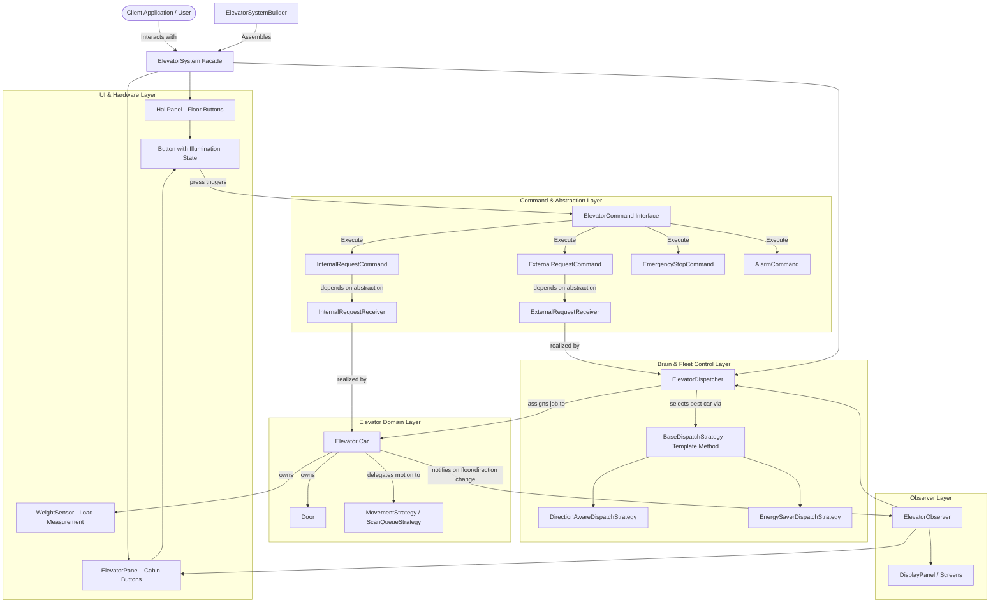
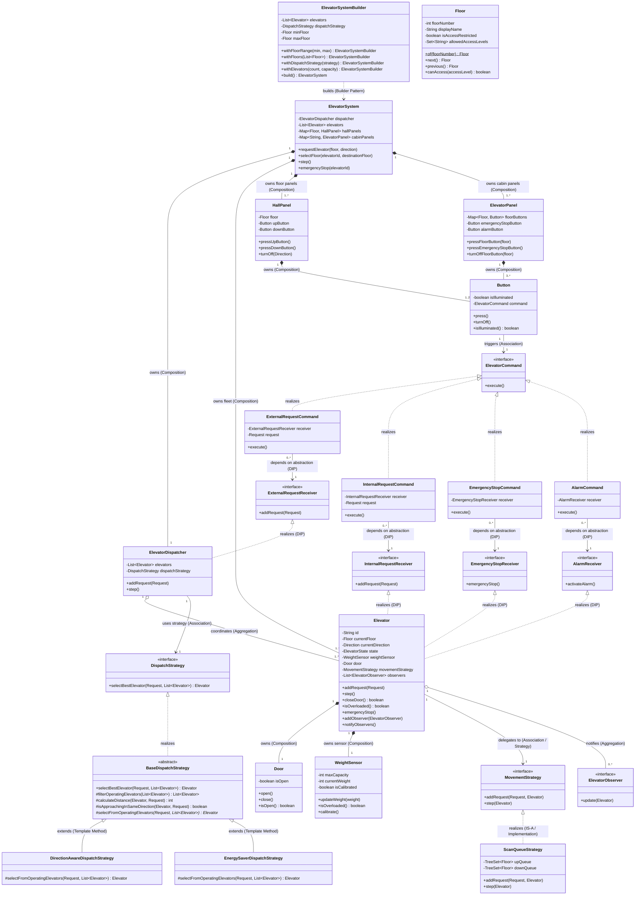
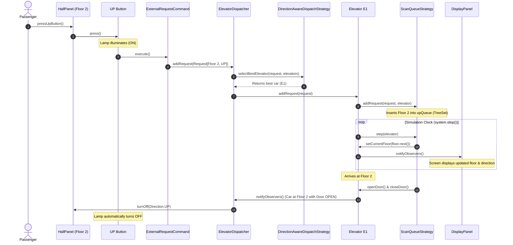
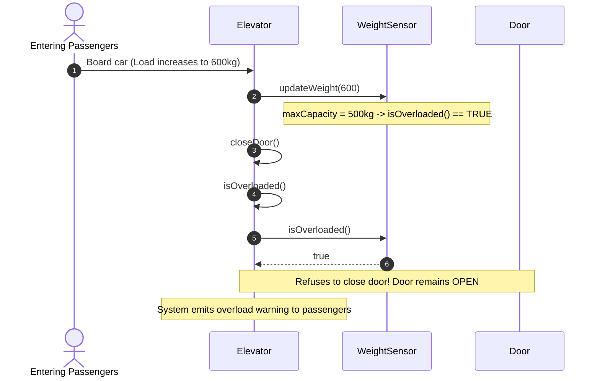
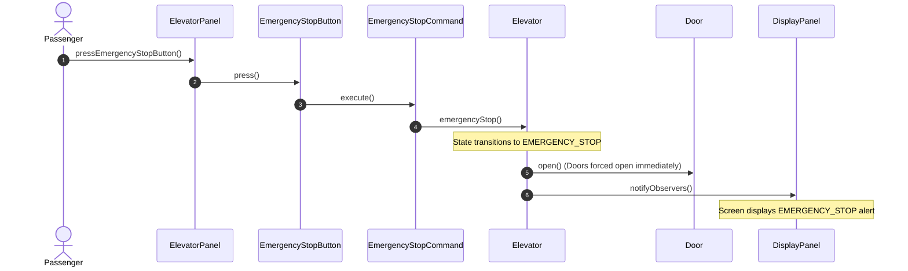

# Multi-Elevator System — Low-Level Design (LLD)

[](https://openjdk.org/projects/jdk/21/)
[](pom.xml)
[](src/test/java/com/elevator)
[](ElevatorDesign.md)

A production-grade, object-oriented Low-Level Design for a multi-elevator system serving a multi-floor commercial building, implemented in Java 21 with Maven.

---

## 1. System Requirements & Feature Matrix

| # | Requirement | Implementation Details | Design Pattern / Component |
| :---: | :--- | :--- | :--- |
| **1** | **Multi-Elevator Fleet** | Supports $N$ elevators operating concurrently with centralized dispatching. | `ElevatorDispatcher`, `ElevatorSystem` |
| **2** | **Hallway Calls (External)** | Floor panels with UP/DOWN buttons routing requests to the optimal car. | `HallPanel`, `ExternalRequestCommand` (Command Pattern + DIP) |
| **3** | **Cabin Calls (Internal)** | In-car floor selection buttons routing directly to the specific elevator. | `ElevatorPanel`, `InternalRequestCommand` (Command Pattern + DIP) |
| **4** | **LOOK / SCAN Movement** | Prevents starvation and unnecessary reversals by serving stops in directional sweeps. | `MovementStrategy`, `ScanQueueStrategy` (Strategy Pattern) |
| **5** | **Direction-Aware & Green Dispatching** | Optimal car selection based on proximity, directional momentum, and energy efficiency. | `BaseDispatchStrategy`, `DirectionAwareDispatchStrategy`, `EnergySaverDispatchStrategy` (Template Method) |
| **6** | **Overload Protection & Sensor** | Physical weight sensor guard with calibration; doors refuse to close and car halts when overloaded. | `WeightSensor`, `Elevator.closeDoor()`, `Elevator.isOverloaded()` |
| **7** | **Emergency & Alarm Safety** | In-car emergency stop immediately halts car, forces door open, and transitions state to EMERGENCY_STOP. | `EmergencyStopCommand`, `AlarmCommand` |
| **8** | **Hardware Button Lifecycle** | Buttons model real physical illumination, prevent duplicate triggers (debounce), and auto-reset on arrival. | `Button` (with illumination & debounce guard) |
| **9** | **Real-Time Display Updates** | External and cabin displays observe elevator state changes (floor, direction, state). | `ElevatorObserver`, `DisplayPanel` (Observer Pattern) |
| **10**| **Fluent Construction & Facade** | Step-by-step system assembly with sensible defaults via fluent builder and single entrypoint. | `ElevatorSystemBuilder` (Builder Pattern), `ElevatorSystem` (Facade Pattern) |

---

## 2. High-Level Architecture

The system cleanly separates **Input Hardware**, **Command Payloads**, **Domain Entities**, **Algorithmic Strategies**, and **Observer Displays**:



---

## 3. Comprehensive Class Diagram



---

## 4. Key Design Patterns Applied

| Design Pattern | Where Applied | Benefit & Interview Takeaway |
| :--- | :--- | :--- |
| **Command Pattern** | `ElevatorCommand`, `InternalRequestCommand`, `ExternalRequestCommand`, `EmergencyStopCommand`, `AlarmCommand` | Completely decouples physical UI buttons from backend receivers (`Elevator`, `ElevatorDispatcher`). Allows adding new buttons/sensors without modifying existing receivers. |
| **Dependency Inversion (DIP)** | `ExternalRequestReceiver`, `InternalRequestReceiver`, `EmergencyStopReceiver`, `AlarmReceiver` | High-level commands do not depend on low-level concrete classes (`ElevatorDispatcher`, `Elevator`); they depend strictly on abstract receiver contracts. |
| **Flyweight Pattern** | `Floor.of(int floorNumber)`, `Floor.CACHE` | Canonical floor instances are shared across the entire system. Prevents repeated heap allocations on high-frequency movement ticks (`floor.next()`, `floor.previous()`). |
| **Template Method Pattern** | `BaseDispatchStrategy` (`selectBestElevator`) | Encapsulates the algorithmic skeleton (filtering operating cars, Manhattan distance, approach direction checks) while subclasses (`DirectionAware`, `EnergySaver`) provide specific cost scoring. |
| **Strategy Pattern** | `MovementStrategy` (`ScanQueueStrategy`), `DispatchStrategy` (`DirectionAwareDispatchStrategy`, `EnergySaverDispatchStrategy`, `EtaSimulationDispatchStrategy`) | Decouples car scheduling sweeps from fleet allocation; algorithms can be swapped dynamically at runtime without modifying elevator logic. |
| **Builder Pattern** | `ElevatorSystemBuilder` | Provides a fluent, validated configuration API to assemble multi-car, multi-floor systems with sensible defaults, validating constraints prior to instantiation. |
| **Factory Pattern** | `PanelFactory` | Encapsulates the complex wiring of hardware buttons, commands, and observers into physical `HallPanel` and `ElevatorPanel` instances. |
| **Observer Pattern** | `ElevatorObserver`, `DisplayPanel`, `ElevatorPanel`, `ElevatorDispatcher` | Loose-coupling telemetry: `Elevator` broadcasts state changes to cabin screens, external displays, and hardware panels (for automatic button lamp turnoff on arrival). |
| **Facade Pattern** | `ElevatorSystem` | Shields clients and simulation loops from internal fleet complexity with a clean, cohesive public API (`requestElevator`, `selectFloor`, `step`, `emergencyStop`, `activateAlarm`). |
| **Mediator Pattern** | `ElevatorDispatcher` | Encapsulates how a set of cars and hall panels interact. Instead of panels broadcasting to all elevators or elevators gossiping P2P, the dispatcher mediates fleet assignments in one centralized coordinator. |
| **Null Object Pattern** | `NoOpCommand` | Replaces null checks with an active no-operation command object (`NoOpCommand.INSTANCE`) for dummy, placeholder, or unassigned hardware buttons. |

---

## 5. SOLID Principles in Action

| Principle | Code Implementation in this Project | Interview Explanation |
| :--- | :--- | :--- |
| **Single Responsibility (SRP)** | • `Elevator`: Manages car physical telemetry, door state, and safety sensors.<br>• `ScanQueueStrategy`: Exclusively schedules movement sweeps.<br>• `ElevatorDispatcher`: Focuses strictly on fleet car selection.<br>• `Button`: Models physical illumination state and debounce logic.<br>• `WeightSensor`: Handles calibration and load thresholds. | Each class has exactly one actor and one reason to change. |
| **Open/Closed (OCP)** | • Adding new dispatch algorithms (e.g., `EtaSimulationDispatchStrategy`) requires zero modifications to `ElevatorDispatcher` or existing strategies.<br>• Adding new commands or observer displays requires zero modifications to `Button` or `Elevator`. | Open for extension via interfaces and abstract bases, closed for modification. |
| **Liskov Substitution (LSP)** | • Any implementation of `DispatchStrategy` (`DirectionAwareDispatchStrategy`, `EnergySaverDispatchStrategy`) can seamlessly substitute for another in `ElevatorDispatcher`.<br>• Any `MovementStrategy` can be plugged into `Elevator`. | Subtypes adhere strictly to the contracts of their base types without throwing unexpected exceptions. |
| **Interface Segregation (ISP)** | • Segregated narrow receiver interfaces: `ExternalRequestReceiver`, `InternalRequestReceiver`, `EmergencyStopReceiver`, `AlarmReceiver`.<br>• `ElevatorObserver` contains only `update(Elevator)`.<br>• `ElevatorCommand` contains only `execute()`. | Clients are not forced to depend on methods they do not use (e.g., `EmergencyStopCommand` only knows `emergencyStop()`, not movement or fleet scheduling). |
| **Dependency Inversion (DIP)** | • `ExternalRequestCommand` depends on `ExternalRequestReceiver` (not `ElevatorDispatcher`).<br>• `InternalRequestCommand` depends on `InternalRequestReceiver` (not `Elevator`).<br>• `EmergencyStopCommand` depends on `EmergencyStopReceiver` (not `Elevator`).<br>• `AlarmCommand` depends on `AlarmReceiver` (not `Elevator`). | High-level modules do not depend on low-level details; both depend on abstractions. |

---

## 6. End-to-End Sequence Diagrams

### 6.1 External Hallway Call & Pickup Flow


### 6.2 Weight Sensor Overload Protection Flow


### 6.3 Emergency Stop Safety Interlock Flow


---

## 7. Algorithmic Deep-Dive: Movement & Dispatching

### 7.1 LOOK / SCAN Movement Algorithm vs FCFS vs SSTF

| Metric | First-Come-First-Serve (FCFS) | Shortest Seek Time First (SSTF) | LOOK / SCAN (Implemented in this project) |
| :--- | :--- | :--- | :--- |
| **Logic** | Serves requests in the exact order they arrive. | Always visits the nearest requested floor next. | Sweeps in one direction serving all stops, then reverses when no further stops remain. |
| **Starvation Risk** | Zero (strict queue). | **High** (distant floors starve if middle floors keep receiving requests). | **Zero** (every stop in the sweep direction is guaranteed to be visited). |
| **Elevator Thrashing** | **Extreme** (car races between floors 1 and 20 repeatedly). | Low, but localizes movement. | **Minimal** (smooth directional momentum). |
| **Time Complexity** | $O(1)$ queue pop. | $O(N)$ linear distance scan. | **$O(\log K)$** via `TreeSet` (`ceiling()` / `floor()`). |

#### Implementation with Java `TreeSet` (Red-Black Tree)
`ScanQueueStrategy` maintains two ordered sets:
```java
private final TreeSet<Floor> upQueue = new TreeSet<>();
private final TreeSet<Floor> downQueue = new TreeSet<>();
```
* When traveling **UP**: Queries `upQueue.ceiling(currentFloor)`. Runs in $O(\log K)$ time.
* When traveling **DOWN**: Queries `downQueue.floor(currentFloor)`. Runs in $O(\log K)$ time.
* Because `Floor` implements `Comparable<Floor>`, ordered traversal is naturally sorted by floor altitude without custom comparators.

### 7.2 Dispatching Strategies & Mathematical Cost Models

#### 1. Direction-Aware Proximity Dispatching (`DirectionAwareDispatchStrategy`)
Scores each operational car using directional momentum:
$$\text{Cost} = |\text{CarFloor} - \text{ReqFloor}| + \text{Penalty}$$
Where:
* **$\text{Penalty} = 0$**: Car is already approaching the request floor in the same direction.
* **$\text{Penalty} = 2$**: Car is parked `IDLE` (can start immediately).
* **$\text{Penalty} = 10$**: Car is moving away or in the opposite direction (must complete its current sweep before serving this call).

#### 2. Green / Energy-Saver Dispatching (`EnergySaverDispatchStrategy`)
Minimizes total building electrical consumption by prioritizing active motor consolidation over idle motor spin-up:
$$\text{Cost} = |\text{CarFloor} - \text{ReqFloor}| + (\text{isCarIdle} ? 8 : 0)$$
* Spinning up an idle motor from rest consumes a massive power inrush.
* Consolidates additional stops into an already-moving elevator unless distance is prohibitive.

---

## 8. Quick Start & Usage Example

Here is how to instantiate and run the multi-elevator system using the fluent builder:

```java
import com.elevator.ElevatorSystem;
import com.elevator.enums.Direction;
import com.elevator.model.Floor;
import com.elevator.strategy.dispatch.DirectionAwareDispatchStrategy;

public class Main {
    public static void main(String[] args) {
        // 1. Build a 10-floor system with 3 elevators
        ElevatorSystem system = ElevatorSystem.builder()
                .withFloors(0, 10)
                .withElevator("E1", 0, 800.0) // 800 kg max capacity
                .withElevator("E2", 0, 800.0)
                .withElevator("E3", 5, 800.0)
                .withDispatchStrategy(new DirectionAwareDispatchStrategy())
                .build();

        // 2. Passenger on Floor 3 calls an elevator to go UP
        system.requestElevator(Floor.of(3), Direction.UP);

        // 3. Step the simulation clock until the car arrives
        system.step();

        // 4. Passenger boards Elevator E1 and selects destination Floor 7
        system.selectFloor("E1", Floor.of(7));

        // 5. Advance the system
        system.step();
    }
}
```

---

## 9. Project Structure

```
src/
├── main/java/com/elevator/
│   ├── ElevatorSystem.java                // High-level public facade
│   ├── ElevatorSystemBuilder.java         // Fluent builder for system assembly
│   ├── model/                             // Core domain entities & services
│   │   ├── Elevator.java                  // Core car aggregate root
│   │   ├── ElevatorDispatcher.java        // Fleet bank coordinator / Mediator / Domain service
│   │   ├── Door.java                      // Car door component with open/close state
│   │   ├── Floor.java                     // Flyweight floor entity (display names, access control)
│   │   └── Request.java                   // Immutable value object (Floor, RequestType)
│   ├── command/                           // Command pattern implementations
│   │   ├── ElevatorCommand.java
│   │   ├── ExternalRequestCommand.java
│   │   ├── InternalRequestCommand.java
│   │   ├── EmergencyStopCommand.java
│   │   ├── AlarmCommand.java
│   │   ├── NoOpCommand.java               // Null Object pattern implementation
│   │   └── receiver/                      // DIP Abstractions
│   │       ├── ExternalRequestReceiver.java
│   │       ├── InternalRequestReceiver.java
│   │       ├── EmergencyStopReceiver.java
│   │       └── AlarmReceiver.java
│   ├── enums/                             // Domain enumerations
│   │   ├── Direction.java                 // UP, DOWN, IDLE
│   │   ├── ElevatorState.java             // OPERATING, MAINTENANCE, EMERGENCY_STOP
│   │   └── RequestType.java               // EXTERNAL_UP, EXTERNAL_DOWN, INTERNAL
│   ├── hardware/                          // Physical button, panel & sensor components
│   │   ├── Button.java                    // Hardware button with illumination & debounce
│   │   ├── HallPanel.java                 // Floor hallway panel (UP/DOWN buttons)
│   │   ├── ElevatorPanel.java             // Cabin panel (Floor buttons + Emergency)
│   │   ├── PanelFactory.java              // Assembly factory for panels
│   │   └── WeightSensor.java              // Load measurement hardware sensor
│   ├── observer/                          // Observer pattern for car telemetry
│   │   ├── ElevatorObserver.java
│   │   └── DisplayPanel.java
│   └── strategy/                          // Algorithmic strategies
│       ├── movement/
│       │   ├── MovementStrategy.java      // Movement contract
│       │   └── ScanQueueStrategy.java     // LOOK/SCAN implementation
│       └── dispatch/
│           ├── DispatchStrategy.java      // Fleet selection contract
│           ├── BaseDispatchStrategy.java  // Abstract base (Template Method)
│           ├── DirectionAwareDispatchStrategy.java
│           ├── EnergySaverDispatchStrategy.java
│           └── EtaSimulationDispatchStrategy.java
└── test/java/com/elevator/
    ├── ElevatorSystemBuilderTest.java     // Tests for fluent builder assembly
    ├── ElevatorSystemIntegrationTest.java // Full end-to-end integration flows
    ├── model/
    │   ├── ElevatorTest.java              // Unit tests for car safety & state
    │   └── FloorTest.java                 // Tests for Floor entity, Flyweight, & navigation
    ├── hardware/
    │   ├── ButtonTest.java                // Tests for hardware button debounce & illumination
    │   ├── PanelTest.java                 // Tests for HallPanel & ElevatorPanel interactions
    │   └── WeightSensorTest.java          // Tests for weight calibration & overload
    └── strategy/
        ├── movement/
        │   └── ScanQueueStrategyTest.java // Tests for LOOK/SCAN floor queuing
        └── dispatch/
            ├── DirectionAwareDispatchStrategyTest.java
            └── EnergySaverDispatchStrategyTest.java
```

---

## 10. Running Tests & Compiling

This project is built with **Java 21** and **Maven**:

```bash
# Compile project
mvn clean compile

# Run all 35 unit and integration test suites
mvn test
```
